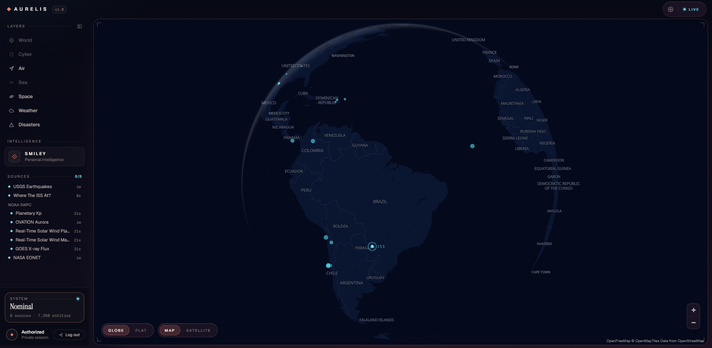

# AURELIS

### Personal Global Situational Dashboard

**Um painel pessoal de consciência situacional global que reúne informações públicas de diferentes fontes em uma única interface, preservando origem, tempo, precisão e proveniência.**

`Next.js` · `React` · `TypeScript` · `MapLibre GL` · `Supabase Auth` · `OpenAI`

---

## Visão geral

O **AURELIS** nasceu como um projeto pessoal para transformar dados públicos dispersos em uma experiência única de observação do mundo.

Em vez de abrir vários sites para acompanhar terremotos, clima espacial, posição da ISS, nuvens, eventos naturais, tráfego aéreo e condições meteorológicas, o AURELIS reúne essas fontes em um mesmo espaço visual e preserva o contexto necessário para interpretar cada informação corretamente.

O projeto não tenta substituir sistemas profissionais de monitoramento, serviços de emergência ou as fontes originais. A proposta é funcionar como um **workspace pessoal de consciência situacional**, no qual mapa, dados e contexto convivem sem esconder a origem da informação.

> **Princípio central:** o AURELIS nunca apresenta como fato algo que os dados não comprovam.

---

## Screenshots

### Desktop

  

### Mobile

  

---

## O que o AURELIS acompanha

| Domínio | Capacidades atuais | Principais fontes |
| --- | --- | --- |
| **SPACE** | ISS em tempo quase real, trilha orbital, Kp, aurora, vento solar, campo magnético interplanetário e raios X solares | Where The ISS At?, NOAA SWPC, NASA |
| **DISASTERS** | Terremotos e eventos naturais abertos, com seleção geográfica e filtros | USGS, NASA EONET |
| **WEATHER** | Inspeção meteorológica por ponto e cobertura global de nuvens | Open-Meteo, NOAA GFS |
| **AIR** | Tráfego aéreo global, altitude, posição e movimento visual entre observações reais | OpenSky Network |
| **SMILEY** | Inteligência pessoal read-only que interpreta o estado atual do AURELIS usando somente o contexto necessário | Dados já carregados no AURELIS + OpenAI Responses API |

Outros domínios, como **SEA**, **CYBER**, **MARKETS** e novas capacidades de contexto global, permanecem no roadmap e só serão adicionados quando existirem fontes e regras de proveniência adequadas.

---

## O mapa é o centro da experiência

O AURELIS usa **MapLibre GL** com um estilo cartográfico próprio sobre dados da OpenFreeMap/OpenMapTiles/OpenStreetMap.

A interface suporta:

- projeção **Globe** e **Flat/Mercator**;
- basemap cartográfico e **Satellite**;
- terremotos, eventos naturais e entidades móveis;
- ISS renderizada em altitude orbital no globo;
- aurora e nuvens como camadas WebGL próprias;
- tráfego aéreo global renderizado com WebGL;
- seleção contextual de entidades e pontos geográficos.

Uma regra importante atravessa toda a arquitetura: **dados só aparecem no mapa quando existe informação geográfica explícita e sustentada pela fonte**. Valores globais, como o índice planetário Kp, ficam em painéis em vez de receber coordenadas artificiais.

---

## Dados antes da estética

AURELIS possui um modelo próprio para separar claramente **o que existe** do **que uma fonte afirma sobre aquilo**.

### Entity

Representa algo acompanhado pelo sistema, como uma aeronave, a ISS ou um evento natural.

### Observation

Representa uma afirmação produzida por uma fonte sobre uma entidade ou fenômeno.

Cada observação pode preservar:

- fonte;
- identificador do registro original;
- horário observado, reportado, válido e ingerido;
- precisão geográfica;
- natureza da evidência;
- confiança, quando existe metodologia para defini-la.

As naturezas usadas incluem:

`observed` · `reported` · `estimated` · `inferred` · `forecast`

Isso permite que o AURELIS mostre, por exemplo, uma medição observada, uma estimativa modelada e uma previsão futura sem tratá-las como se fossem a mesma coisa.

---

## SMILEY — Personal Intelligence

**AURELIS é a plataforma. SMILEY é a inteligência pessoal dentro dela.**

O SMILEY não é uma fonte factual e não adiciona informações inventadas ao modelo de dados. Ele funciona como uma camada de interpretação sobre aquilo que o AURELIS já sabe.

A arquitetura atual é deliberadamente restritiva:

- read-only;
- sem ações autônomas;
- sem web search próprio;
- sem memória persistente nesta versão;
- uma pergunta gera no máximo uma chamada ao modelo;
- o contexto enviado é selecionado de forma determinística;
- somente os domínios relevantes entram em cada requisição;
- dados das fontes são tratados como conteúdo não confiável para instruções.

Exemplo: ao perguntar sobre um terremoto selecionado, o SMILEY recebe o contexto daquele evento, sua proveniência e os dados relevantes, em vez de receber todo o estado do aplicativo.

O objetivo é transformar grandes volumes de dados em **contexto útil sem perder a distinção entre fato, estimativa e interpretação**.

---

## Desktop e mobile são experiências diferentes

A evolução visual do AURELIS passou a tratar desktop e telefone como interfaces distintas para o mesmo núcleo de dados.

### Desktop

O desktop funciona como um **situational intelligence workspace**:

- mapa amplo como protagonista;
- navegação lateral;
- inspectors e painéis especializados;
- SMILEY integrado ao workspace;
- temas **Ember**, **Atlas** e **Basalt**.

### Mobile

O telefone é tratado como um **personal situational intelligence app**:

- mapa em tela cheia;
- navegação por tabs;
- Map, SMILEY e Settings como destinos principais;
- seleção de Layers ancorada ao mapa;
- sheets e popovers contextuais;
- estado do mapa preservado ao alternar entre telas;
- interações próprias por domínio.

A intenção é que essa separação facilite uma futura implementação mobile nativa sem duplicar o core de dados e regras do AURELIS.

---

## Fontes e integrações

O AURELIS trabalha principalmente com fontes públicas e especializadas:

- **USGS** — terremotos;
- **NASA EONET** — eventos naturais;
- **NOAA SWPC** — clima espacial, Kp, aurora, vento solar, IMF e raios X;
- **NOAA GFS** — cobertura global de nuvens;
- **Open-Meteo** — clima por ponto;
- **Where The ISS At?** — posição da ISS;
- **OpenSky Network** — tráfego aéreo;
- **Esri World Imagery** — basemap de satélite;
- **OpenFreeMap / OpenMapTiles / OpenStreetMap** — base cartográfica.

As respostas internas do AURELIS não usam o formato bruto dessas APIs diretamente. Cada integração possui adapters responsáveis por validar e normalizar os dados antes que eles cheguem ao modelo e à interface.

---

## Stack

- **Next.js 16** — App Router
- **React 19**
- **TypeScript**
- **Tailwind CSS 4**
- **MapLibre GL**
- **WebGL / WebGL2** para camadas customizadas
- **Supabase Auth** para acesso privado
- **OpenAI Responses API** para o SMILEY
- **Railway** para deployment

A aplicação mantém segredos e credenciais sensíveis no servidor. As APIs operacionais são protegidas por autenticação antes de qualquer chamada às fontes externas.

---

## Estado do projeto

**AURELIS 1.0.0 foi lançado e versionado.**

A série **1.1** está focada em identidade visual, UX e separação mais clara entre as experiências desktop e mobile.

O projeto continua pessoal, privado e single-user. Ele também funciona como um experimento de engenharia: explorar até onde uma pessoa pode construir um sistema desse tipo combinando programação, APIs públicas, visualização de dados e ferramentas modernas de IA como apoio ao desenvolvimento.

A IA é uma ferramenta de desenvolvimento e uma capacidade interna do produto por meio do SMILEY; ela **não é autora nem fonte dos dados apresentados**.

---

## Limitação conhecida

O domínio **AIR** usa OpenSky Network e funciona em ambientes que conseguem alcançar a infraestrutura do serviço.

No deployment atual do Railway, conexões com os hosts da OpenSky apresentam timeout antes de qualquer resposta HTTP. Por isso, AIR pode aparecer como `SOURCE UNAVAILABLE` em produção sem comprometer os demais domínios.

A migração ou adaptação do provider de tráfego aéreo permanece planejada para uma etapa posterior.

---

## Próximos passos

Entre as próximas evoluções planejadas estão:

- concluir o refinamento visual e de UX da série **AURELIS 1.1**;
- memória persistente privada para o **SMILEY**;
- Personal Attention Engine;
- Intel Scout para poucos acontecimentos realmente relevantes;
- contexto científico, astronômico e eventos programados;
- domínio marítimo quando houver uma fonte adequada;
- revisão da integração AIR para ambientes hospedados;
- futura landing pública / portfolio e modo demo.

> **AURELIS is never finished forever. Versions are finished.**

---

## Repositório

GitHub: https://github.com/IsraelOliver/Aurelis

---

**AURELIS**  
*Personal Global Situational Dashboard*

